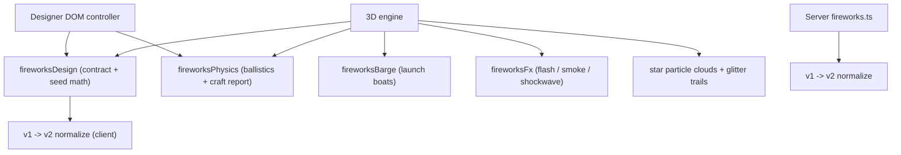

# 烟花物理重做

Feature Name: fireworks-physics-rework
Updated: 2026-10-24

## Description

把烟花从「视觉参数」升级为「装药与星体的物理模型」：设计台按真实制作流程组织参数并给出工艺卡；3D 引擎按同一套弹道与星体模型燃放，并补齐发射船、升空壳、拖尾、爆闪、烟雾与水面反光。

## Architecture



设计器与 3D 引擎共享纯模块 `fireworksDesign` 与 `fireworksPhysics`，避免预览与观赏出现两套公式。服务端保存 `v: 2`；读取旧数据时转换为 v2，客户端对社区旧数据同样转换。

## Components and Interfaces

### 协议（客户端与镜像）

`FireworkDesign` 增加字段：`caliber`、`liftCharge`、`breakCharge`、`launchAngle`、`starCount`、`starSize`、`burnTime`、`trail`，版本号升为 `2`。旧 `size` 字段仅在 v1 输入中出现。

### fireworksPhysics.ts

- `planShell(design)`：按目标高度、发射药、发射角与海风计算初速、升空时间、引信时长、实际开爆高度与水平偏移。
- `burstRadius(design)`：按弹径与开爆药计算开爆半径。
- `craftReport(design)`：返回工艺卡数字与风险提示。
- `sampleStar(seed, age, elapsed)`：解析式求解带线性阻力、重力、海风与十字分裂的星体位置、透明度、尺寸。
- `recommendedLift(caliber)` / `recommendedBreak(caliber)`：设计器推荐装药。

### fireworksEngine.ts

- 升空壳：解析弹道 + 壳模型 + 拖尾 + 引信。
- 爆裂：每个星体按 `sampleStar` 求值，按 `trail` 与 `sparkle` 发射尾迹。
- 特效：爆闪、冲击波、烟雾、水面反光。
- 复用主 `Scene` 与主 renderer，不创建 WebGL 上下文。

### fireworksBarge.ts

在燃放海域生成 2–3 艘低多边形发射船：木甲板、炮管架、灯笼、货箱与旗帜。提供炮口位置与 `update(elapsed)`。

### fireworksFx.ts

管理一次性特效对象（Sprite/Mesh/Points），统一 `update` 与 `dispose`。

### fireworksMortars.ts

发射船与炮口的世界坐标单一事实源：三艘船的位姿、九根炮管的世界坐标/朝向，
以及最近的炮口选择。渲染（`fireworksBarge.ts`）、弹道推导与观景取景共用，
避免三处各自维护魔法数字。

### showFraming.ts

观景秀的按幕取景（纯模块）：根据本幕真实设计推导开爆点与爆裂云外沿，
用固定偏移正交相机的基向量把锚点投到画面坐标，解出注视点 `targetX/targetZ`
与正交半高 `zoom`，并显式留出屏底 HUD 的空间。

- 固定机位不可行的原因：相机俯角约 49.6°，纵向世界位移被放大。要让
  `height=90` 且 `launchAngle=18°` 的爆点入画，`zoom` 需约 90，此时发射船
  仅剩约 1.8% 屏宽；按典型设计取景（`zoom≈45`）则极端设计溢出约 1.5 屏宽。
- 约束：`cameraController` 每帧把 `target.y` 归到地形高度，因此取景只解
  `targetX/targetZ/zoom`，并调用同一 `terrainHeight` 复算注视高度。
- 确定性：炮口按幕序号选，同幕成员使用互不重复的炮管；同一 seed 与视口
  得到同一取景，便于测试与回放。
- 演出接入：每幕先 `focus` 到本幕取景，延时 `ACT_LEAD_IN_MS` 后点火；影院
  运镜期间锁定滚轮/捏合缩放，避免用户打乱已算好的取景。

## Data Models

```ts
type FireworkDesign = {
  v: 2;
  height: number;        // 开爆高度，24–90
  shape: FireworkShape;
  colors: { primary: string; secondary: string; trail: string };
  breakCharge: number;   // 开爆药，5–200 g
  sparkle: number;       // 闪烁 0–100
  caliber: number;       // 50–300 mm
  liftCharge: number;    // 10–300 g
  launchAngle: number;   // 0–18 deg
  starCount: number;     // 40–600
  starSize: number;      // 4–18 mm
  burnTime: number;      // 1–6 s
  trail: 'none' | 'comet' | 'glitter';
  pattern?: FireworkPattern;
};
```

v1 转换：`breakCharge = round(recommendedBreak(150) * size / 100)`，其余新字段取默认值（150 mm / 推荐发射药 / 0° / 300 星 / 9 mm / 3 s / comet）。

## Correctness Properties

1. 对同一设计，2D 预览与 3D 引擎得到同一升空时间、开爆高度与星体初速。
2. 星数、星体尺寸、燃烧时间与尾迹只由设计字段决定，不受渲染帧率影响。
3. 所有随机量来自可重置的种子随机，预览与引擎分布一致。
4. 旧 v1 设计经客户端或服务端转换后，再次保存得到合法 v2 设计。
5. 所有调用 `dispose()` 后，场景中不残留烟花对象与自建材质。

## Error Handling

- 服务端拒绝非法 v2 字段，返回既有 `error` 消息，不扣金币。
- 客户端在设计不合法时显示具体中文字段提示。
- 旧数据无法转换时按默认烟花处理，列表不因单行损坏而失败。
- 音效缺失、贴图创建失败不影响粒子主流程。

## Test Strategy

- 单元：`fireworksPhysics.test.ts` 覆盖弹道、开爆半径、星体数量/寿命、v1 转换。
- 服务端：扩展 `tests/fireworks.mjs`，覆盖 v2 保存、v1 迁移、非法参数。
- 浏览器：扩展 `tests/fireworks.spec.ts`，覆盖新滑杆、工艺卡、拼字保存与观景模式；
  观景用例额外断言进入/退出时相机 `zoom` 随按幕取景变化并恢复。
- 取景单测：`fireworksFraming.test.ts` 覆盖炮口表、按幕发射点、典型与极端
  设计在各视口比例下不出画、以及同一 seed 的确定性。

## References

- `apps/web/src/city/fireworks/fireworksDesign.ts`
- `apps/web/src/city/fireworks/showFraming.ts`
- `apps/web/src/city/fireworks/fireworksMortars.ts`
- `apps/web/src/rendering/fireworksEngine.ts`
- `apps/server/src/fireworks.ts`
- Issue #256
